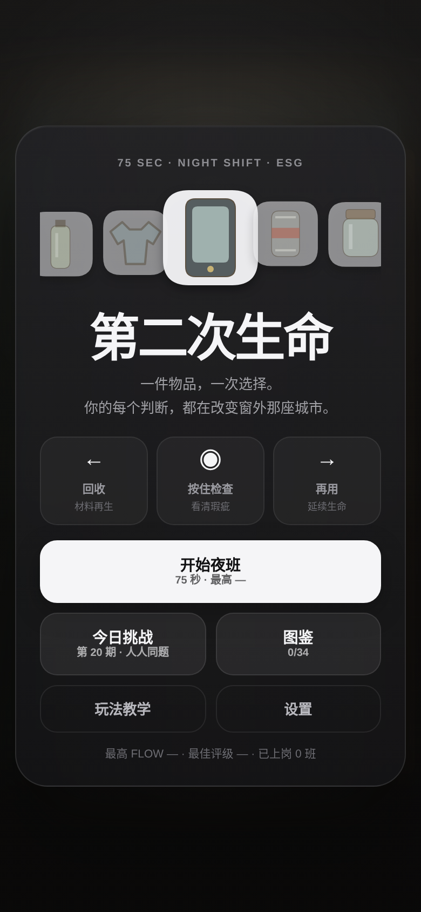
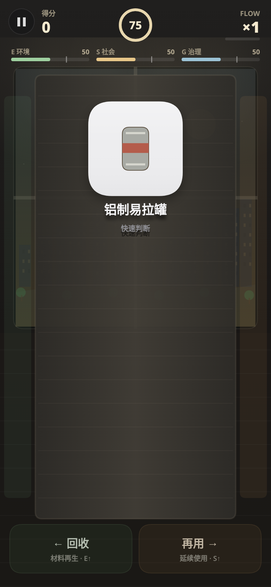

# 第二次生命 · 75 秒夜班

> 一件物品，一次选择。你的每个判断，都在改变窗外那座城市。

一款关于**回收、再用与可持续选择**的免费网页小游戏。你是夜班分拣员：传送带不停向前，物品一件接一件地到来。空瓶该回收，旧衣还能再穿；旧手机能不能修，只有看清它的状态才知道。

每班只有 **75 秒**。你不仅要分对物品，还会遇到安全、效率与诚信之间的抉择。下班时，分数会结算，城市也会给出自己的回答。

<p align="center">
  
  &nbsp;&nbsp;
  
</p>

## ▶ 开始游戏

**在线体验：** 本仓库启用 GitHub Pages 后，访问

`https://你的GitHub用户名.github.io/second-life-75s/`

无需安装、注册或下载 App；也可以直接下载仓库中的 `index.html`，用现代浏览器打开。仓库创建和上线操作见 [部署指南](DEPLOY.md)。

## 怎么玩

| 操作 | 含义 | 提示 |
| --- | --- | --- |
| **← 向左划 / A / ←** | 回收 | 将适合再生处理的物品送入回收渠道 |
| **→ 向右划 / D / →** | 再用 | 完好、可修复的物品可以继续流通 |
| **长按约 0.4 秒 / 空格 / I** | 检查 | 发现鼓包、烧蚀、裂纹等容易忽视的细节 |
| **底部左右区域点击** | 快速分拣 | 鼠标也能轻松游玩 |
| **P / Esc** | 暂停 | 在暂停界面可继续、调整音效或退出 |

第一次游玩会进入三步教学。

## 特色

- **75 秒夜班：** 时间压力、连对加分和最后 10 秒冲刺。
- **34 种可分拣物品：** 从纸箱、衣物到手机、太阳能板；部分物品有不同的状态和隐藏瑕疵。
- **6 类工作抉择：** 设备报警、供应商标签、劳动防护、加急订单、数据诚信与社区捐赠。每局随机遇到其中两次。
- **E / S / G 三项指标：** 环境、社会与治理不总能靠高分同时实现。
- **每日挑战：** 每天固定的随机种子，方便与朋友挑战同一天的题目。
- **战报与好友挑战：** 生成分享图片，复制带分数的挑战链接。
- **物品图鉴：** 记录已经遇到过的物品；本地保存最佳成绩、设置和图鉴进度。
- **原生浏览器实现：** Canvas 2D、JavaScript、Web Audio、localStorage；不依赖前端框架、后端或构建工具。

## 设计说明

游戏更关心**物品的实际状态**，而不只是标签是否写着“环保”。还能使用的东西，延长寿命有时比立即拆解更有价值；涉及破损电池、漏电设备或防护装备时，人的安全比快速得分重要。

**现实提醒：** 本游戏为公众教育与互动体验，分拣逻辑做过简化。危险废物、废旧电池、灯具、电器等的实际处理方式以当地规定与专业回收渠道为准。

## 技术与隐私

仓库根目录的 [`index.html`](index.html) 即全部游戏主体，静态托管即可运行，无需数据库和 API 密钥。游戏数据保存在当前浏览器的 `localStorage` 中，不会自动上传到服务器。分享战报时，只有用户主动执行分享或复制操作才会生成对应内容。

## 项目文件

```text
second-life-75s/
├── index.html         # 游戏完整源码，也是 GitHub Pages 首页
├── assets/
│   ├── screenshot.png # 首页实机截图
│   └── gameplay.png   # 游戏实机截图
├── README.md          # 项目介绍
├── CHANGELOG.md       # 更新记录
├── DEPLOY.md          # GitHub 上传与上线步骤
├── .nojekyll          # 按原样发布静态文件
└── .gitignore
```

## 运行和部署

本地打开 `index.html` 即可开始游玩；如要模拟线上地址，可在仓库根目录执行：

```bash
python -m http.server 8000
```

然后访问 `http://localhost:8000/`。公开发布只需上传文件并启用 GitHub Pages，详细步骤见 [DEPLOY.md](DEPLOY.md)。

## 版权与授权

**尚未指定开源许可证。** 本仓库不附加 `LICENSE`，表示没有主动授予公众复制、修改或再发布的许可；公开可访问不等于自动开源。仓库所有者应在发布前确认代码及素材的使用权，并自行选择是否加入 MIT、GPL、CC 等许可协议。此项目未继承参考项目的版权或许可。

---

*左划回收，右划再用。75 秒后，你想让城市变成什么样？*
